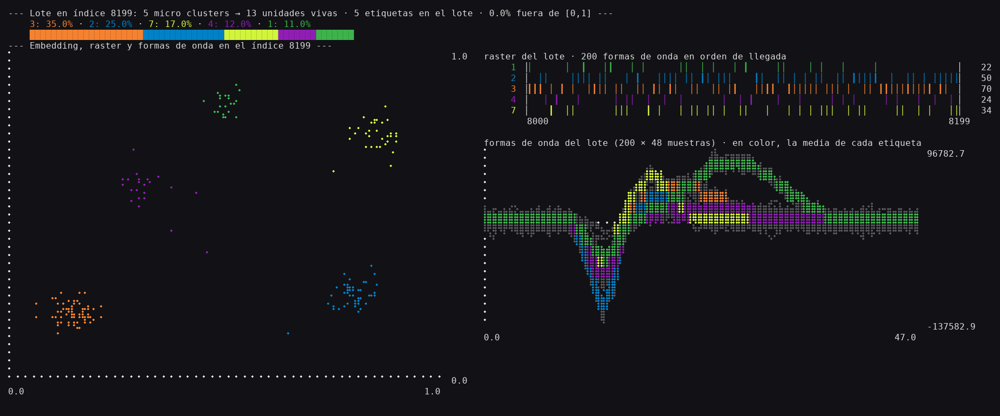

# umap-mcqueen

Reducción de dimensiones a tiempo real y *offline* por medio de UMAP e implementado en Rust para mayor eficiencia en recursos y tiempo.

----

El algoritmo usado es ' fast-umap ', una implementación de UMAP en Rust que a parte de ser mucho más veloz, es paramétrica, por lo que rompe con la limitación usual de UMAP que es no poder aceptar nuevos datos en base a un encaje ya realizado.

Después de ser reducidos de dimensionalidad, se usa un algoritmo de clustering usual.



Su única funcionalidad actual es tomar un archivo ' .csv ' e iterar sobre sus datos sólo aplicando UMAP por lotes. Lo siguiente es TODO:

- Realizar el clustering final.
- Mostrar a color las clasificaciones.
- Implementar la lectura a tiempo real de un *web socket*.

-----

## Características deseables

- Codigo mínimo.
- Funcionalidades mínimas.
- Adaptable a otros módulos.

-----

## Datos simulados con MEArec

`scripts/simula_monocanal_mearec.py` simula registros extracelulares con [MEArec](https://mearec.readthedocs.io)
(neuronas biofísicas de capa 5 del Blue Brain Project alrededor de una sonda Neuronexus-32) y exporta canales
sueltos como electrodos monocanal, con los mismos archivos que `monocanal` (`spikes.csv`, `labels.csv`,
`times.csv`, `unidades.csv`). Cada registro sortea, con una semilla maestra, el número de neuronas, las tasas,
las ráfagas, el ruido, la deriva y las amplitudes dentro de rangos fisiológicos (`RANGOS` en el script).

Generar plantillas necesita NEURON 8 y LFPy, que no funcionan en Windows: se corre en WSL. Preparación (Arch,
como root; en otra distribución, el equivalente de `gcc make perl`):

```sh
pacman -S --needed gcc make perl                  # NEURON compila los mecanismos .mod con ellos
curl -LsSf https://astral.sh/uv/install.sh | sh   # uv, en ~/.local/bin
uv venv ~/mearec-env --python 3.12                # NEURON 8 no tiene versión para Python 3.14
uv pip install --python ~/mearec-env/bin/python 'MEArec[templates]'
```

Si una generación de plantillas falla a medias (por ejemplo, porque faltaba `perl`), MEArec deja la carpeta
`~/.config/mearec/<versión>/cell_models/bbp/mods` sin compilar y no la vuelve a compilar: hay que borrarla.

```sh
PY=~/mearec-env/bin/python
# Una vez: 780 plantillas con deriva a 30 kHz (unos 7 min con 20 núcleos, ~670 MB)
$PY scripts/simula_monocanal_mearec.py plantillas --out ~/mearec/plantillas_nnx32_30k.h5
# Registros: 8 canales al azar por registro, 600 s cada uno (~2 min por registro; en serie
# para que la misma semilla dé exactamente los mismos datos)
$PY scripts/simula_monocanal_mearec.py registros --plantillas ~/mearec/plantillas_nnx32_30k.h5 \
    --out /mnt/c/<ruta>/data/mearec --n-registros 6 --semilla 1
```

La frecuencia de muestreo se fija con las plantillas (`--fs-khz`, 30 por defecto): MEArec 1.11 falla al
remuestrear plantillas con deriva, así que los registros salen siempre a la frecuencia de su biblioteca.
