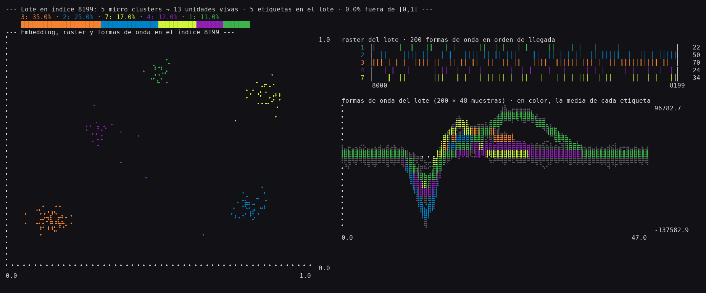

# umap-mcqueen

Reducción de dimensiones a tiempo real y *offline* por medio de UMAP e implementado en Rust para mayor eficiencia en recursos y tiempo.

----

El algoritmo usado es ' fast-umap ', una implementación de UMAP en Rust que a parte de ser mucho más veloz, es paramétrica, por lo que rompe con la limitación usual de UMAP que es no poder aceptar nuevos datos en base a un encaje ya realizado.

Después de ser reducidos de dimensionalidad, se usa un algoritmo de clustering usual.



Su única funcionalidad actual es tomar un archivo ' .csv ' e iterar sobre sus datos sólo aplicando UMAP por lotes. Lo siguiente es TODO:

- Realizar el clustering final.
- Mostrar a color las clasificaciones.
- Implementar la lectura a tiempo real de un *web socket*.

-----

## Características deseables

- Codigo mínimo.
- Funcionalidades mínimas.
- Adaptable a otros módulos.

-----

## Qué hay en el repositorio

```
umap-mcqueen/
├── Cargo.toml            # el núcleo (biblioteca `umap_mcqueen` + la CLI `umap-mcqueen`) y el workspace
├── Cargo.lock            # uno solo, para los dos crates
├── src/lib.rs            # modelo (manifiesto + carga verificada), normaliza, spikesim, configuracion()
├── src/main.rs           # la CLI: entrena o carga un modelo, proyecta por lotes, DenStream y gráfica
├── tests/semilla.rs      # la prueba de la semilla
├── tdc_umap/             # el puente a tridesclous: crate `tdc-umap` (pyo3) = módulo de Python `tdc_umap._core`
├── pyproject.toml        # el paquete de Python `tdc_umap`, construido por maturin
└── python/tdc_umap/      # el motor `engine='umap'` para el Peeler de tridesclous, sus herramientas y sus pruebas
```

`tdc_umap` depende del núcleo **como crate** (`umap-mcqueen = { path = ".." }`), no copiando ficheros: el manifiesto
del modelo, la normalización y la configuración de UMAP existen una sola vez, y el `Cargo.lock` del workspace fija
las mismas versiones de `fast-umap`, `burn`, `cubecl` y `clump` para los dos crates. Lo que la CLI guarda, el motor
lo carga con el mismo formato, por construcción.

## Compilar desde un clon limpio

Hace falta `cargo` ≥ 1.85 (`edition = "2024"`; con `rustup` basta) y, para **correr**, una GPU con Vulkan: el
backend es `wgpu`. Compilar no la necesita.

```bash
git clone https://github.com/ocelotzin/umap-mcqueen && cd umap-mcqueen
cargo build --release      # el núcleo, la CLI y tdc_umap; fast-umap llega del fork de abajo, por git
cargo test --release       # las pruebas de normaliza.rs, modelo.rs e identidades.rs, y las de la semilla (usan la GPU)
./target/release/umap-mcqueen Waveforms.csv --train 2000 --lote 200 --semilla 7 --modelo modelos/m7
```

Y el paquete de Python, con el motor para tridesclous:

```bash
python -m venv .venv && . .venv/bin/activate
pip install maturin && pip install -e .    # trae tridesclous (el commit del pipeline) y compila tdc_umap._core
pytest python/tdc_umap/tests               # las pruebas del motor, con un clasificador falso: sin GPU
```

En el entorno del pipeline, que ya tiene tridesclous por su submódulo (el mismo commit), `pip install --no-deps -e .`
para no reinstalarlo.

## El motor `engine='umap'` para el Peeler de tridesclous

Clasifica sin plantillas: recorta cada forma de onda como el constructor de catálogos, la proyecta con la red que
entrenó `umap-mcqueen` y la agrupa con DenStream. Vive en `python/tdc_umap/`:

* `peeler_engine_umap.py` — el motor: `change_params(engine='umap', catalogue=..., umap_modelo='modelos/s1', ...)`,
  en modo `sincrono` o `asincrono` (un hilo que agrupa lotes; con `umap_campo_canal=True` cada espiga lleva su canal).
* `umap_tools.py` — exporta las formas de onda de un `CatalogueConstructor` al CSV que entrena `umap-mcqueen`, con
  su descripción de la extracción (`<base>.tdc.json`), y produce el catálogo sin plantillas:
  `python -m tdc_umap.umap_tools <dir DataIO> <base del modelo>`.
* `tdc_umap.Clasificador` — la clase compilada (Rust): carga el modelo por su manifiesto, lo comprueba y clasifica
  lotes `(n, n_dim)`; devuelve etiquetas, encaje, fracción fuera de rango y recuentos de DenStream.

**El alta es explícita.** tridesclous no sabe que este paquete existe; `Peeler.change_params` busca el motor en el
diccionario `peeler_engines`, y `tdc_umap.registrar()` lo pone ahí:

```python
import tdc_umap
tdc_umap.registrar()                      # una vez por proceso; repetirlo no hace nada nuevo
peeler.change_params(engine='umap', catalogue=catalogo, umap_modelo='modelos/s1')
```

**La versión de tridesclous** es la que corre el pipeline, fijada por commit en `pyproject.toml`
(`josemal98/tridesclous-edited`, rama `upstream-mas-mmap`, 5e3fac8). El motor solo le importa
`peakdetector`, `peeler_tools` y `signalpreprocessor`, en forma absoluta; nada se parchea.

El puente `tdc_umap/` (Rust) tiene tres ficheros propios: `motor.rs` (normaliza → `transform` → normaliza →
DenStream, por lote, una etiqueta por forma de onda), `identidades.rs` (ids estables entre lotes: DenStream solo da
posiciones en un `Vec`, que cambian con cada poda) y `lib.rs` (la clase de Python y la configuración de UMAP,
reconstruida del manifiesto del modelo). Si `modelo.rs` cambia su API pública (`carga_verificada`, `Manifiesto`,
`RutasDelModelo`), habrá que ajustar `motor.rs`/`lib.rs`; nada más.

## La semilla

`--semilla <n>` (por defecto 9999) siembra **todos** los generadores del entrenamiento: la inicialización de la red en
el backend y el muestreo de aristas de cada época. Con los mismos datos, la misma configuración y la misma semilla
salen los mismos pesos, byte a byte; con otra semilla, otro modelo. El manifiesto del modelo la guarda (`"semilla"`,
formato 4); los manifiestos de formato 3, anteriores, se siguen cargando con la semilla desconocida.

Comprobarlo es `cargo test --release --test semilla`: entrena dos veces con la semilla 7 y una con la 8, carga los
tres modelos y proyecta los mismos datos con ellos; los dos de la semilla 7 coinciden coordenada a coordenada
(diferencia máxima 0) y el de la 8 no. Lo mismo, con `fast-umap` directo, para el encaje de entrenamiento.

Lo que **no** sirve es comparar los `.bin` byte a byte: burn sortea un identificador por parámetro al crear la red
y lo escribe en el fichero, así que dos modelos con los mismos pesos difieren en unos 50 bytes (medido: 51 de 13 022
con la misma semilla, frente a 12 190 con otra). Y lo que la semilla **no** fija es lo que viene después del encaje:
DenStream (`clump`) tiene su propio azar.

Antes de esto, dos entrenamientos idénticos diferían hasta un 19 % de la escala del encaje: `fast-umap` 1.6.0 solo
siembra el backend, y sus generadores de CPU salían de la entropía.

## fast-umap: por qué un `[patch]`, y cuándo se retira

`fast-umap` 1.6.0 (crates.io) no deja fijar la semilla. Mientras upstream no publique una versión que sí, `Cargo.toml`
sustituye el crate por el fork [`josemal98/fast-umap`](https://github.com/josemal98/fast-umap), rama `seed-config`:
un solo commit sobre el `master` de upstream (que es la 1.6.0 exacta) con `UmapConfig::seed`, propuesto a upstream
como PR. `Cargo.lock` fija el commit.

**Se retira** el día que crates.io traiga `fast-umap` con semilla configurable: se borra el bloque `[patch.crates-io]`
de `Cargo.toml`, se sube la versión de `fast-umap` y se archiva el fork. Nada más cambia.
